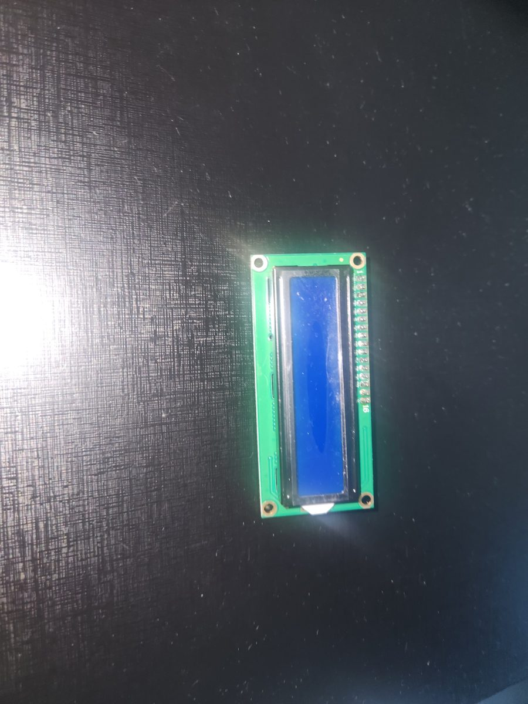
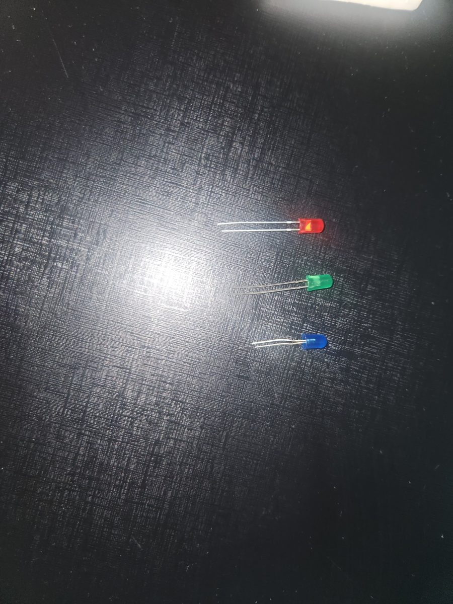
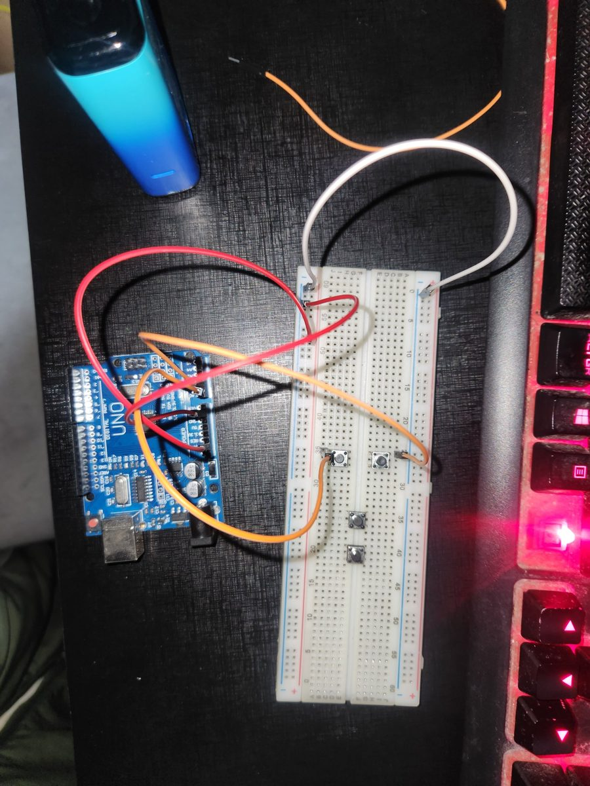

# 🎵 Reprodutor de Músicas — Arduino UNO

**CCP020 · Digital Experience Ultimate** · Centro Universitário FEI
**Aluno:** Henrik Mezedes Batista · **Prof.:** Isaac

Reprodutor de músicas com menu, 4 botões, 3 LEDs de status e buzzer. As músicas ficam guardadas na memória FLASH do Arduino.

<p align="center">
  
</p>

---

## Sumário
1. [Introdução](#1-introdução)
2. [Como usar](#2-como-usar)
3. [Materiais](#3-materiais)
4. [Ligações](#4-ligações)
5. [Montagem passo a passo](#5-montagem-passo-a-passo)
6. [Como carregar o código](#6-como-carregar-o-código)
7. [Como o código funciona](#7-como-o-código-funciona)
8. [Simulação no Wokwi](#8-simulação-no-wokwi)
9. [Experimentos](#9-experimentos)
10. [Tecnologias utilizadas](#10-tecnologias-utilizadas)
11. [Conclusão](#11-conclusão)

---

## 1. Introdução
<!-- Escreva com suas palavras: o problema proposto e os objetivos. -->

---

## 2. Como usar

**Botões**

| Botão | No menu | Tocando | Pausado |
|---|---|---|---|
| ⬆️ **UP** | sobe na lista | — | — |
| ⬇️ **DOWN** | desce na lista | — | — |
| ⏯️ **PLAY/PAUSE** | toca a música escolhida | pausa | continua de onde parou |
| ⏹️ **STOP** | — | volta ao menu | volta ao menu |

**LEDs**

| LED | Significado |
|---|---|
| 🟢 Verde | música tocando |
| 🔴 Vermelho | música pausada |
| 🔵 Azul | pisca no ritmo de cada nota *(extra)* |

**Músicas:** Ode à Alegria · Brilha Brilha Estrelinha · Parabéns pra Você · Jingle Bells · Für Elise · Tetris

**Tela:** o menu aparece no LCD 16x2 e também no **Monitor Serial** do PC (9600 baud), desenhado como uma telinha:

```
+----------------+
|>Ode a Alegria  |
| Brilha Brilha  |
+----------------+
```

---

## 3. Materiais

| Arduino UNO | Display LCD 16x2 | LEDs |
|:---:|:---:|:---:|
|  |  |  |

| Qtd | Componente | Observação |
|---|---|---|
| 1 | Arduino UNO | |
| 1 | Display LCD 16x2 | ligado em modo 4 bits |
| 4 | Botões 6×6 mm | |
| 3 | LEDs (verde, vermelho, azul) | |
| 3 | Resistores 220 Ω | um por LED |
| 1 | Resistor 1 kΩ | contraste do LCD |
| 1 | Buzzer **passivo** | o ativo não toca notas |
| 1 | Protoboard 830 pontos | |
| ~30 | Jumpers macho-macho | |
| 12 | Jumpers macho-fêmea | só para o LCD |

---

## 4. Ligações

Pinos do Arduino usados, agrupados pela barra onde ficam:

**Barra DIGITAL**

| Pino | Liga em | Cor do fio |
|---|---|---|
| 2, 3, 4, 5 | LCD D7, D6, D5, D4 | — |
| 6 | LED verde (via 220 Ω) | 🟩 verde |
| 7 | LED vermelho (via 220 Ω) | ⬜ branco |
| 8 | Buzzer (+) | 🟪 roxo |
| 9 | LED azul (via 220 Ω) | 🟦 azul |
| 11 | LCD E | — |
| 12 | LCD RS | — |

**Barra POWER / ANALOG IN**

| Pino | Liga em | Cor do fio |
|---|---|---|
| 5V | linha **+** da protoboard | 🟥 vermelho |
| GND | linha **−** da protoboard | ⬛ preto |
| A0 | Botão UP | 🟨 amarelo |
| A1 | Botão DOWN | 🟨 amarelo |
| A2 | Botão PLAY/PAUSE | 🟨 amarelo |
| A3 | Botão STOP | 🟨 amarelo |

> Os botões usam o resistor de *pull-up* interno do Arduino (`INPUT_PULLUP`): cada botão liga o pino ao GND quando é apertado, sem resistor externo.

---

## 5. Montagem passo a passo

### Como a protoboard funciona
- **Meio:** os 5 furos de uma mesma coluna (**a–e** ou **f–j**) são ligados entre si. O vão do meio separa as duas metades.
- **Trilhos (+ e −):** cada linha é ligada de ponta a ponta. Nesta protoboard eles são **divididos no meio**, então um jumper liga as duas metades.
- **Ligar um fio numa perna** = colocar o fio em qualquer furo livre da **mesma coluna** daquela perna, do mesmo lado do vão.

### Etapa 1 — Alimentação
1. **5V** do Arduino → linha **+**.
2. **GND** do Arduino → linha **−**.
3. Um jumper liga o **− de cima** ao **− de baixo**.
4. Um jumper em cada linha **−** atravessa a divisão do meio (perto da coluna 30).

### Etapa 2 — Botões
Cada botão ocupa **duas linhas**. O fio que vai ao Arduino entra na linha das **pernas de cima**; o fio que vai ao **−** entra na linha das **pernas de baixo**.

<p align="center">
  
  
</p>

> 💡 Se um botão parecer sempre apertado ou nunca responder, gire-o 90° no mesmo lugar.

### Etapa 3 — LEDs e buzzer
Para cada peça: **um fio para o Arduino** e **um fio para o −**.

| Peça | Fio do Arduino vai em | Fio do − sai de |
|---|---|---|
| LED azul | ponta solta do resistor | perna curta do LED |
| LED verde | ponta solta do resistor | perna curta do LED |
| LED vermelho | ponta solta do resistor | perna curta do LED |
| Buzzer | perna **+** | perna **−** |

> 💡 A perna **longa** do LED é o **+** e fica do lado do resistor. O resistor pode ser encaixado em qualquer sentido.

### Etapa 4 — LCD *(pendente)*
O LCD tem pinos de só 3 mm, que não firmam na protoboard. Ele é ligado com **12 jumpers macho-fêmea**: a ponta fêmea vai no pino do LCD e a macho na protoboard. Os pinos 7 a 10 (D0–D3) ficam sem ligação.

| Pino do LCD | Liga em |
|---|---|
| 1 VSS · 5 RW · 16 K | linha − |
| 2 VDD · 15 A | linha + |
| 3 V0 | resistor 1 kΩ → linha − (contraste) |
| 4 RS | pino 12 |
| 6 E | pino 11 |
| 11 D4 · 12 D5 · 13 D6 · 14 D7 | pinos 5 · 4 · 3 · 2 |

<details>
<summary>📍 Posição exata de cada peça na protoboard (colunas)</summary>

Protoboard deitada: colunas 1–63, fileiras **a–e** (metade de cima) e **f–j** (metade de baixo).

| Peça | Posição | Fios |
|---|---|---|
| LCD | pino N do LCD → furo aN | ver tabela da Etapa 4 |
| Resistor 1 kΩ | c17 → c23 | e3 → e17; e23 → − |
| Botão UP | metade de cima, colunas 25 e 27 | a25 → A0; a27 → − |
| Botão DOWN | metade de baixo, colunas 25 e 27 | j25 → A1; j27 → − |
| Botão PLAY/PAUSE | atravessando o vão, colunas 34 e 36 | a34 → A2; j36 → − |
| Botão STOP | atravessando o vão, colunas 39 e 41 | a39 → A3; j41 → − |
| LED azul | 220 Ω c45→c51; LED longa a51, curta a52 | pino 9 → e45; e52 → − |
| LED verde | 220 Ω h45→h51; LED longa f51, curta f52 | pino 6 → j45; j52 → − |
| LED vermelho | 220 Ω h54→h60; LED longa f60, curta f61 | pino 7 → j54; j61 → − |
| Buzzer | − a57, + a60 | pino 8 → e60; e57 → − |

</details>

---

## 6. Como carregar o código

1. Coloque `reprodutor.ino` e `musicas.h` numa pasta chamada **`reprodutor`**.
2. Abra o `reprodutor.ino` na **Arduino IDE**.
3. Escolha **Ferramentas → Placa → Arduino Uno** e a **Porta** (`/dev/ttyUSB0` ou `/dev/ttyACM0` no Linux).
4. Clique em **Carregar** (→).
5. Abra **Ferramentas → Monitor Serial** em **9600** para ver a tela.

<details>
<summary>🐧 Configuração no Fedora</summary>

```bash
flatpak install flathub cc.arduino.IDE2   # Arduino IDE
sudo usermod -aG dialout $USER            # permissão da porta USB (sair e entrar de novo)
sudo dnf remove brltty                    # só se a porta não aparecer (conflita com o chip CH340)
```
</details>

### Teste de hardware
A pasta `teste/` tem um programa que testa cada peça separadamente: acende os LEDs um a um, toca um bip e mostra no Monitor Serial cada botão apertado. Use-o para achar mau contato antes de carregar o reprodutor.

---

## 7. Como o código funciona

- **Músicas na FLASH:** o UNO tem só 2 KB de RAM, então as melodias ficam em `PROGMEM` (`musicas.h`) e são lidas nota a nota com `pgm_read_word`.
- **Formato das músicas:** pares `{frequência, duração}`. A duração é a figura musical (4 = semínima, 8 = colcheia…; negativa = pontuada) e é convertida em milissegundos pelo BPM de cada música.
- **Sem `delay()` na reprodução:** o `loop()` usa `millis()` para saber quando a nota acabou, então os botões respondem durante a música.
- **Máquina de estados:** `MENU` → `TOCANDO` ⇄ `PAUSADO` → `MENU`. Ao fim da música, volta sozinho para o menu.
- **Botões sem repique:** cada botão só conta uma vez por toque (*debounce* de 30 ms).
- **Tela dupla:** a função `tela()` escreve as mesmas duas linhas no LCD e no Monitor Serial.

| Arquivo | Conteúdo |
|---|---|
| `reprodutor.ino` | menu, botões, LEDs e reprodução |
| `musicas.h` | notas e lista das 6 músicas |
| `teste/teste.ino` | teste de hardware |
| `diagram.json` | circuito para o Wokwi |
| `fotos/` | fotos do projeto |

---

## 8. Simulação no Wokwi
1. Abra [wokwi.com/projects/new/arduino-uno](https://wokwi.com/projects/new/arduino-uno).
2. Cole o `reprodutor.ino` na aba **sketch.ino** e o `diagram.json` na aba **diagram.json**.
3. Crie o arquivo `musicas.h` (seta ▾ → *New file*) e cole o conteúdo.
4. Clique em ▶. Teclado: **↑ ↓** = UP/DOWN · **P** = play/pause · **S** = stop.

---

## 9. Experimentos
<!-- Sequência de fotos do funcionamento com explicações + link do vídeo. -->

---

## 10. Tecnologias utilizadas
- Arduino IDE · C++ (Arduino)
- Biblioteca `LiquidCrystal`
- `avr/pgmspace.h` (PROGMEM)
- Monitor Serial
- Wokwi (simulação)
- Git / GitHub

---

## 11. Conclusão
<!-- Descreva com detalhes como você resolveu o problema e as dificuldades. -->
