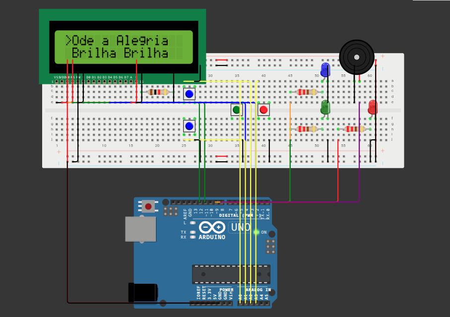
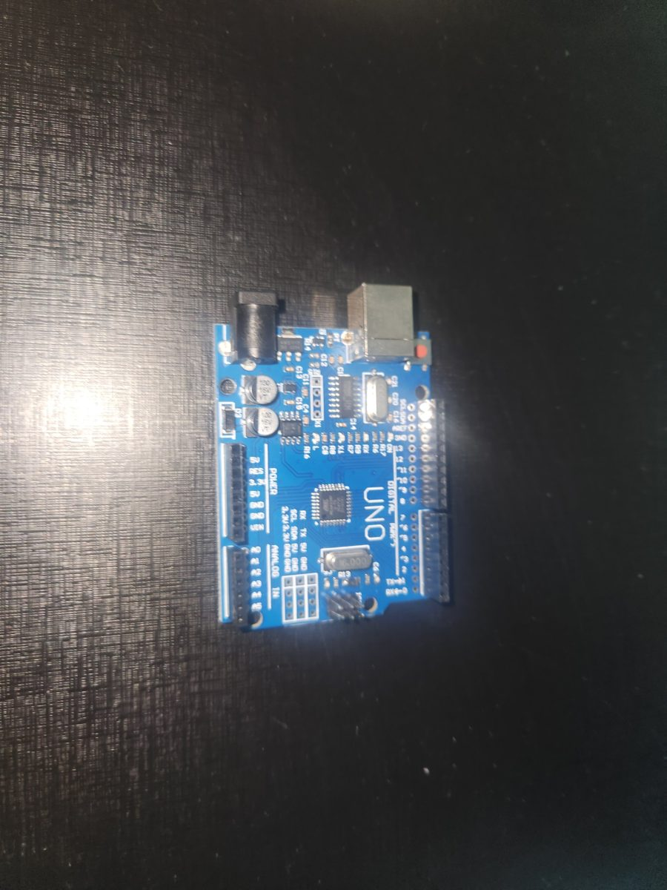
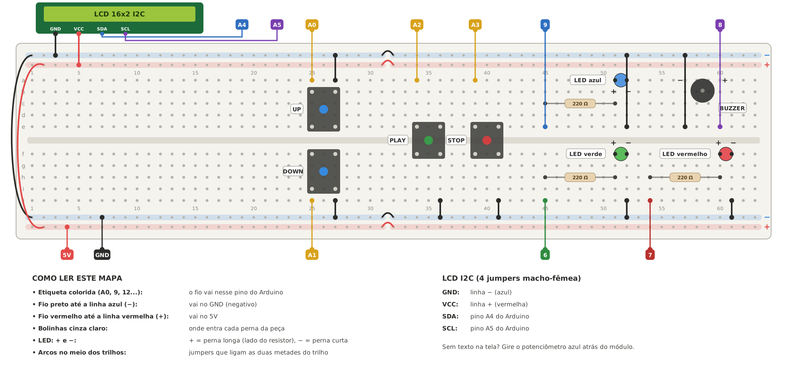
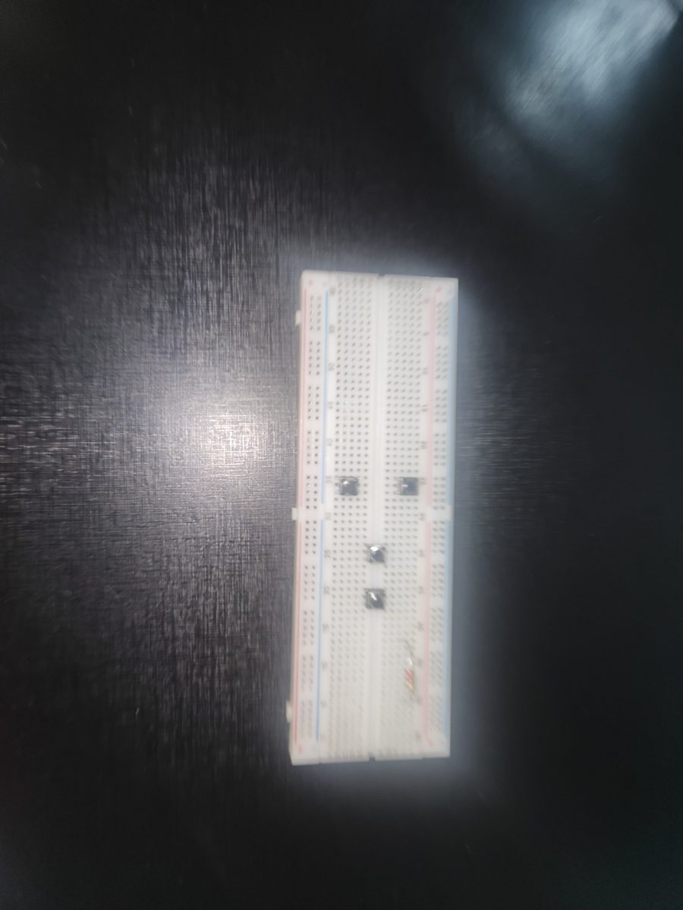
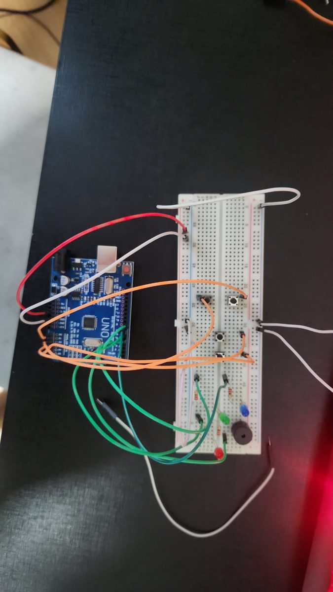
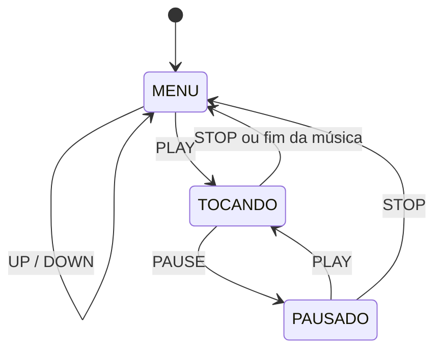
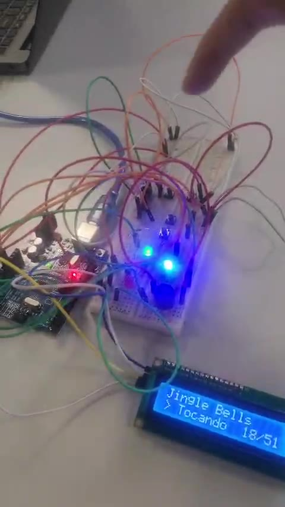
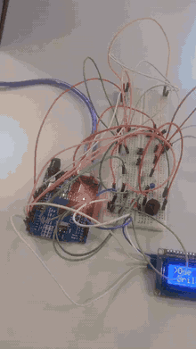

# Reprodutor de Músicas com Arduino UNO

**Disciplina:** CCP020 — Digital Experience Ultimate
**Instituição:** Centro Universitário FEI
**Aluno:** Henrik Mezedes Batista
**Professor:** André

Reprodutor de músicas com menu em display LCD 16x2 (módulo I2C), quatro botões de controle, três LEDs de estado e saída de áudio por buzzer. As melodias ficam armazenadas na memória FLASH do microcontrolador.

<p align="center">
  
  <br><em>Figura 1 — Circuito completo simulado no Wokwi, com o menu exibido no LCD.</em>
</p>

---

## Sumário
1. [Introdução](#1-introdução)
2. [Requisitos do projeto](#2-requisitos-do-projeto)
3. [Como usar](#3-como-usar)
4. [Materiais](#4-materiais)
5. [Esquema de ligações](#5-esquema-de-ligações)
6. [Montagem na protoboard](#6-montagem-na-protoboard)
7. [Funcionamento do código](#7-funcionamento-do-código)
8. [Como compilar e carregar](#8-como-compilar-e-carregar)
9. [Simulação no Wokwi](#9-simulação-no-wokwi)
10. [Experimentos](#10-experimentos)
11. [Tecnologias utilizadas](#11-tecnologias-utilizadas)
12. [Inspirações e fontes](#12-inspirações-e-fontes)
13. [Conclusão](#13-conclusão)

---

## 1. Introdução
<!-- Escreva com suas palavras: o problema proposto e os objetivos do projeto. -->

---

## 2. Requisitos do projeto

| Requisito do enunciado | Como foi atendido |
|---|---|
| Menu de músicas no display LCD 16x2 | Menu com a música selecionada e a próxima da lista |
| Botões UP e DOWN para navegar | Pinos A0 e A1, com navegação circular |
| Botão PLAY/PAUSE | Pino A2: toca, pausa e retoma do ponto onde parou |
| Botão STOP | Pino A3: interrompe a música e volta ao menu |
| LED verde enquanto toca | Pino 6 |
| LED vermelho quando pausado | Pino 7 |
| Música tocada no buzzer | Pino 8, com a função `tone()` |
| No mínimo 5 músicas na memória FLASH | 6 músicas em `PROGMEM` |
| **Extra:** LED que pisca no ritmo | Pino 9: acende enquanto cada nota soa |
| **Extra:** tela no computador | O menu também é exibido no Monitor Serial |

---

## 3. Como usar

### Controles

| Botão | No menu | Durante a música | Com a música pausada |
|---|---|---|---|
| **UP** | sobe na lista | — | — |
| **DOWN** | desce na lista | — | — |
| **PLAY/PAUSE** | toca a música selecionada | pausa | continua de onde parou |
| **STOP** | — | volta ao menu | volta ao menu |

### Indicadores

| LED | Estado |
|---|---|
| Verde | música tocando |
| Vermelho | música pausada |
| Azul | pisca no ritmo de cada nota |

Quando a música termina, o sistema volta sozinho para o menu.

### Músicas disponíveis
1. Ode à Alegria — L. van Beethoven
2. Brilha Brilha Estrelinha — melodia tradicional francesa
3. Parabéns pra Você — Mildred J. Hill e Patty Hill
4. Jingle Bells — J. L. Pierpont
5. Für Elise — L. van Beethoven
6. Tetris (Korobeiniki) — canção folclórica russa

Todas são de domínio público.

### Tela
O menu aparece no LCD e também no **Monitor Serial** da Arduino IDE (9600 baud), desenhado como uma tela de 16x2:

```
+----------------+
|>Ode a Alegria  |
| Brilha Brilha  |
+----------------+
```

---

## 4. Materiais

| Arduino UNO | Display LCD 16x2 | LEDs |
|:---:|:---:|:---:|
|  |  |  |

| Qtd | Componente | Função |
|---|---|---|
| 1 | Arduino UNO |
| 1 | Display LCD 16x2 com módulo I2C |
| 4 | Botões táteis 6×6 mm |
| 3 | LEDs 5 mm (verde, vermelho, azul) |
| 3 | Resistores 220 Ω |
| 1 | Buzzer passivo |
| 1 | Protoboard 830 pontos |
| ~30 | Jumpers macho-macho | ligações |
| 4 | Jumpers macho-fêmea |

> **Observação:** o buzzer precisa ser **passivo**. O buzzer ativo emite um único tom fixo e não reproduz as notas.

---

## 5. Esquema de ligações

### Arduino — barra DIGITAL

| Pino | Componente |
|---|---|
| 6 | LED verde (via 220 Ω) |
| 7 | LED vermelho (via 220 Ω) |
| 8 | Buzzer (+) |
| 9 | LED azul (via 220 Ω) |

### Arduino — barras POWER e ANALOG IN

| Pino | Componente |
|---|---|
| 5V | linha **+** da protoboard |
| GND | linha **−** da protoboard |
| A0 | Botão UP |
| A1 | Botão DOWN |
| A2 | Botão PLAY/PAUSE |
| A3 | Botão STOP |
| A4 | LCD SDA (dados I2C) |
| A5 | LCD SCL (relógio I2C) |

### LCD 16x2 com módulo I2C

| Pino do módulo | Ligação |
|---|---|
| GND | linha − (GND) |
| VCC | linha + (5V) |
| SDA | pino A4 |
| SCL | pino A5 |

O módulo I2C converte os 16 pinos do LCD em apenas 4 fios. No Arduino UNO, o barramento I2C fica fixo nos pinos **A4 (SDA)** e **A5 (SCL)**. O endereço padrão do módulo é `0x27`; alguns usam `0x3F` (o programa de teste mostra qual é o seu). O contraste é ajustado no potenciômetro azul atrás do módulo.

### Por que os botões não têm resistor
Os botões usam o resistor de *pull-up* interno do ATmega328P (`INPUT_PULLUP`). Com o botão solto, o pino lê `HIGH`; ao apertar, o botão liga o pino ao GND e ele passa a ler `LOW`. Isso dispensa os resistores externos e simplifica a montagem.

---

## 6. Montagem na protoboard

### Como a protoboard funciona
- **Área central:** os 5 furos de uma mesma coluna (**a–e** ou **f–j**) são ligados entre si. O vão do meio separa as duas metades.
- **Trilhos + e −:** cada linha é ligada de ponta a ponta. Nesta protoboard os trilhos são **divididos no meio**, por isso um jumper liga as duas metades.
- **Regra prática:** ligar um fio a uma perna é colocar o fio em um furo livre da **mesma coluna** dessa perna, do mesmo lado do vão.

### Mapa completo

<p align="center">
  
  <br><em>Figura 2 — Posição de cada peça e de cada fio na protoboard. As etiquetas coloridas indicam o pino do Arduino.</em>
</p>

### Etapa 1 — Alimentação
1. **5V** do Arduino na linha **+**.
2. **GND** do Arduino na linha **−**.
3. Um jumper liga o **−** de cima ao **−** de baixo.
4. Um jumper em cada linha **−** atravessa a divisão do meio do trilho.

### Etapa 2 — Botões
Cada botão ocupa **duas linhas**. O fio que vai ao Arduino sai da linha das **pernas de cima**, e o fio que vai ao **−** sai da linha das **pernas de baixo**, sempre do mesmo lado do vão em que o botão está.

<p align="center">
 
  
  <br><em>Figura 3 — Alimentação e botões na protoboard.</em>
</p>

> **Dica:** se um botão parecer sempre apertado ou nunca responder, gire-o 90° no mesmo lugar. Os botões de 4 pernas têm dois pares de pernas já ligados internamente.

### Etapa 3 — LEDs e buzzer
Cada peça recebe **um fio vindo do Arduino** e **um fio indo para o −**.

| Peça | Fio do Arduino | Fio para o − |
|---|---|---|
| LED azul | ponta livre do resistor | perna curta do LED |
| LED verde | ponta livre do resistor | perna curta do LED |
| LED vermelho | ponta livre do resistor | perna curta do LED |
| Buzzer | perna **+** | perna **−** |

> A perna **longa** do LED é o **+** (ânodo) e fica do lado do resistor. O resistor não tem polaridade.

<p align="center">
  
  <br><em>Figura 4 — Montagem completa com botões, LEDs e buzzer.</em>
</p>

### Etapa 4 — LCD
O LCD com módulo I2C fica fora da protoboard e usa **4 jumpers macho-fêmea**: a ponta fêmea vai no pino do módulo, e a ponta macho vai no trilho ou no Arduino, conforme a tabela da seção 5. Se a tela acender mas não mostrar texto, gire o potenciômetro azul atrás do módulo com uma chave de fenda pequena.

<details>
<summary><strong>Posição exata de cada peça na protoboard (clique para abrir)</strong></summary>

<br>Protoboard deitada: colunas 1 a 63, fileiras **a–e** (metade de cima) e **f–j** (metade de baixo).

| Peça | Posição | Fios |
|---|---|---|
| LCD I2C | fora da protoboard | GND → −; VCC → +; SDA → A4; SCL → A5 |
| Botão UP | metade de cima, colunas 25 e 27 | a25 → A0; a27 → − |
| Botão DOWN | metade de baixo, colunas 25 e 27 | j25 → A1; j27 → − |
| Botão PLAY/PAUSE | atravessando o vão, colunas 34 e 36 | a34 → A2; j36 → − |
| Botão STOP | atravessando o vão, colunas 39 e 41 | a39 → A3; j41 → − |
| LED azul | resistor c45–c51; LED: longa a51, curta a52 | pino 9 → e45; e52 → − |
| LED verde | resistor h45–h51; LED: longa f51, curta f52 | pino 6 → j45; j52 → − |
| LED vermelho | resistor h54–h60; LED: longa f60, curta f61 | pino 7 → j54; j61 → − |
| Buzzer | − em a57, + em a60 | pino 8 → e60; e57 → − |

</details>

---

## 7. Funcionamento do código

### Estrutura dos arquivos

| Arquivo | Conteúdo |
|---|---|
| `reprodutor.ino` | menu, leitura dos botões, LEDs e reprodução |
| `musicas.h` | notas musicais e lista das 6 músicas |
| `teste/teste.ino` | programa de teste do hardware |
| `diagram.json` | circuito para simulação no Wokwi |
| `libraries.txt` | bibliotecas usadas na simulação |
| `fotos/` | fotos e capturas do projeto |
| `video/` | vídeo do projeto funcionando (com som) |

### Máquina de estados
O programa é organizado em três estados. Cada botão tem um efeito diferente conforme o estado atual.



### Músicas na memória FLASH
O ATmega328P tem só **2 KB de RAM** e **32 KB de FLASH**. Se as melodias ficassem na RAM, faltaria memória. Por isso elas são declaradas com `PROGMEM` e lidas uma nota por vez com `pgm_read_word()`:

```cpp
const int16_t odeAlegria[] PROGMEM = {
  NOTE_E4,4, NOTE_E4,4, NOTE_F4,4, NOTE_G4,4, ...
};

int16_t freq = pgm_read_word(&m.notas[i * 2]);
```

Resultado da compilação: cerca de **35% da FLASH** e **33% da RAM** usados.

### Formato das notas
Cada nota é um par `{frequência, figura}`:
- **frequência** em Hz (`NOTE_A4` = 440 Hz; `REST` = pausa);
- **figura musical:** 1 = semibreve, 2 = mínima, 4 = semínima, 8 = colcheia, 16 = semicolcheia; valor **negativo** = nota pontuada (1,5×).

A duração em milissegundos é calculada a partir do andamento (BPM) de cada música:

```
semibreve (ms) = 60000 × 4 / BPM
duração        = semibreve / figura      (× 1,5 se pontuada)
```

Cada nota soa por 90% da duração, e os 10% restantes ficam em silêncio para separar notas repetidas.

### Reprodução sem `delay()`
Em vez de parar o programa com `delay()` a cada nota, o `loop()` verifica com `millis()` se a nota atual já terminou. Assim o Arduino continua lendo os botões durante a música, e pausar ou parar responde na hora.

```cpp
if (millis() - inicioNota >= duracaoNota) {
  notaAtual++;            // passa para a próxima nota
  tocaNota(notaAtual);
}
```

### Pausa e retomada
Ao pausar, o programa guarda quanto tempo da nota atual já passou. Ao retomar, toca só o restante dessa nota e segue a partir dela.

### Leitura dos botões
Cada botão é lido por **detecção de borda** (só conta a passagem de solto para apertado) com *debounce* de 30 ms, para que um toque não seja contado várias vezes.

### Tela dupla
A função `tela()` escreve as mesmas duas linhas no LCD e no Monitor Serial. Isso permitiu testar o menu antes de o LCD estar ligado.

---

## 8. Como compilar e carregar

1. Coloque `reprodutor.ino` e `musicas.h` numa pasta chamada **`reprodutor`**.
2. Instale a biblioteca do LCD: **Ferramentas → Gerenciar Bibliotecas**, busque **LiquidCrystal I2C** e instale a de **Frank de Brabander**.
3. Abra o `reprodutor.ino` na **Arduino IDE**.
4. Selecione **Ferramentas → Placa → Arduino Uno** e a **Porta** (`/dev/ttyUSB0` ou `/dev/ttyACM0` no Linux, `COMx` no Windows).
5. Clique em **Carregar**.
6. Abra **Ferramentas → Monitor Serial** em **9600 baud** para ver a tela.

<details>
<summary><strong>Configuração no Linux (Fedora)</strong></summary>

```bash
flatpak install flathub cc.arduino.IDE2   # instala a Arduino IDE
sudo usermod -aG dialout $USER            # permissão da porta USB (sair e entrar na sessão)
sudo dnf remove brltty                    # só se a porta não aparecer (conflito com o chip CH340)
```
</details>

### Teste de hardware
O programa `teste/teste.ino` verifica cada componente separadamente: procura o LCD no barramento I2C e mostra o endereço dele, acende os LEDs um a um, toca um bip no buzzer e mostra no Monitor Serial cada botão apertado. Ele ajuda a localizar fios mal encaixados antes de carregar o reprodutor.

---

## 9. Simulação no Wokwi

O circuito completo pode ser simulado no navegador, sem nenhum componente físico:

1. Abra [wokwi.com/projects/new/arduino-uno](https://wokwi.com/projects/new/arduino-uno).
2. Cole o `reprodutor.ino` na aba **sketch.ino** e o `diagram.json` na aba **diagram.json**.
3. Crie os arquivos `musicas.h` e `libraries.txt` (seta ao lado das abas → *New file*) e cole o conteúdo de cada um. O `libraries.txt` faz o Wokwi instalar a biblioteca do LCD I2C.
4. Clique em **Start**.

Atalhos de teclado: **↑** = UP, **↓** = DOWN, **P** = PLAY/PAUSE, **S** = STOP.

---

## 10. Experimentos

### Experimento 1 — Simulação no Wokwi
O circuito completo foi montado no simulador Wokwi para validar o código antes da montagem física. O menu aparece corretamente no LCD, com a música selecionada marcada por `>` e a próxima música logo abaixo (Figura 1).

### Experimento 2 — Montagem física
<!-- Descreva o teste na placa real: o que funcionou, quais problemas apareceram e como foram resolvidos. -->

<p align="center">
  
  <br><em>Figura 5 — Montagem física funcionando: "Jingle Bells" tocando (nota 18 de 51), com o LED azul aceso no ritmo da música.</em>
</p>

### Vídeo
<p align="center">
  
  <br><em>Demonstração (20 s): navegação no menu e reprodução com os LEDs indicando o estado.</em>
  <br><a href="video/reprodutor-funcionando.mp4">Baixar o vídeo original com som (.mp4)</a>
</p>

---

## 11. Tecnologias utilizadas
- **Linguagem:** C++ (Arduino)
- **IDE:** Arduino IDE 2
- **Bibliotecas:** `LiquidCrystal_I2C` e `Wire` (display I2C) e `avr/pgmspace.h` (memória FLASH)
- **Funções principais:** `tone()`, `noTone()`, `millis()`, `pgm_read_word()`, `pinMode(INPUT_PULLUP)`
- **Simulação:** Wokwi
- **Depuração:** Monitor Serial
- **Versionamento:** Git e GitHub

---

## 12. Inspirações e fontes

### Inspirações
- **arduino-songs (Robson Couto):** repositório com melodias para Arduino que inspirou o formato `{nota, figura}`, com valores negativos para notas pontuadas. As melodias deste projeto foram transcritas separadamente e guardadas em `PROGMEM`.
  <https://github.com/robsoncouto/arduino-songs>
- **Exemplo toneMelody (Arduino):** exemplo oficial que usa `tone()` com tabela de notas (`pitches.h`) e figuras musicais.
  <https://www.arduino.cc/en/Tutorial/BuiltInExamples/toneMelody>

### Documentação consultada
- Arduino — função `tone()`: <https://docs.arduino.cc/language-reference/en/functions/advanced-io/tone/>
- Arduino — função `noTone()`: <https://docs.arduino.cc/language-reference/en/functions/advanced-io/noTone>
- Arduino — `PROGMEM`: <https://docs.arduino.cc/language-reference/en/variables/utilities/PROGMEM/>
- Biblioteca LiquidCrystal_I2C: <https://github.com/johnrickman/LiquidCrystal_I2C>
- Arduino — LCD 16x2 e controlador HD44780: <https://docs.arduino.cc/learn/electronics/lcd-displays>
- Arduino — Blink Without Delay (temporização com `millis()`): <https://docs.arduino.cc/built-in-examples/digital/BlinkWithoutDelay>
- Arduino — Input Pullup Serial (`INPUT_PULLUP`): <https://docs.arduino.cc/built-in-examples/digital/InputPullupSerial/>
- Arduino — Digital Pins (resistores de pull-up internos): <https://docs.arduino.cc/learn/microcontrollers/digital-pins>
- Wokwi — referência do botão (`wokwi-pushbutton`): <https://docs.wokwi.com/parts/wokwi-pushbutton>
- Adafruit — Multi-tasking the Arduino (por que evitar `delay()`): <https://learn.adafruit.com/multi-tasking-the-arduino-part-1>

### Ferramentas de apoio
- **Assistente de IA (Claude):** usado para recomendar fontes de consulta (documentação e referências listadas acima) e para ajudar a organizar os tópicos deste README.
- **Wokwi:** simulação do circuito antes da montagem física.

---

## 13. Conclusão
O objetivo do projeto era construir um reprodutor de músicas no Arduino UNO com menu em LCD, quatro botões de controle, LEDs de estado e saída de áudio por buzzer, guardando pelo menos cinco melodias na memória FLASH. Todos os requisitos do enunciado foram atendidos, além de dois extras: um LED que pisca no ritmo das notas e a exibição do menu também no Monitor Serial.

### Como o problema foi resolvido
A solução foi dividida em partes independentes. Primeiro, as melodias foram organizadas em `musicas.h` como pares `{frequência, figura}`, o que permitiu calcular a duração de cada nota a partir do andamento da música em vez de escrever tempos fixos em milissegundos. Como o ATmega328P tem apenas 2 KB de RAM, as músicas foram guardadas com `PROGMEM` e lidas uma nota por vez com `pgm_read_word()`, deixando a RAM livre para o restante do programa.

Em seguida, o comportamento do reprodutor foi modelado como uma máquina de três estados (MENU, TOCANDO e PAUSADO). Isso deixou claro o que cada botão deve fazer em cada situação e evitou condições confusas espalhadas pelo código. Para que os botões respondessem mesmo durante a música, a reprodução foi feita sem `delay()`: o `loop()` apenas verifica, com `millis()`, se a nota atual já terminou. Com isso também foi possível implementar a pausa que retoma exatamente do ponto onde a música parou.

Por fim, o circuito foi validado no Wokwi antes da montagem física, o que separou os erros de código dos erros de ligação, e o programa `teste/teste.ino` foi usado para conferir cada componente da placa real isoladamente.

### Dificuldades encontradas
- **Montagem física:** a maior dificuldade foi montar o circuito na protoboard. Os trilhos de alimentação divididos ao meio, a posição de cada fio na mesma coluna da perna do componente e o ajuste de contraste do LCD exigiram várias conferências até tudo funcionar.
- **Botões:** precisei fazer vários testes nos botões. Os botões de 4 pernas têm pares já ligados internamente, então, dependendo da orientação, eles pareciam sempre apertados ou não respondiam. Usei o programa `teste/teste.ino` para ver no Monitor Serial cada botão apertado e corrigir a posição deles. No código, um toque também podia ser contado várias vezes por causa da trepidação mecânica, o que resolvi com detecção de borda e *debounce* de 30 ms.
- **LED azul no ritmo da música:** fazer o LED azul acompanhar as notas foi um desafio, porque ele precisa acender e apagar junto com cada nota sem atrapalhar a reprodução. A solução foi ligar o LED apenas enquanto a nota está soando (os primeiros 90% da duração) e apagá-lo no silêncio entre as notas e nas pausas (`REST`), usando o mesmo controle de tempo com `millis()` da reprodução.
- **Memória limitada:** com as melodias na RAM, o programa não caberia no Arduino. A solução foi usar a memória FLASH com `PROGMEM`.
- **Responsividade dos botões:** com `delay()` o Arduino ficaria travado durante cada nota e não perceberia os botões. A temporização com `millis()` resolveu o problema.

### O que aprendi
O projeto mostrou na prática como as limitações de hardware influenciam o software: a quantidade de RAM definiu onde guardar os dados, e a necessidade de ler botões durante a música definiu a forma de controlar o tempo. Também aprendi a usar uma máquina de estados para organizar um programa interativo, a usar os resistores de *pull-up* internos, a comunicar com o LCD pelo barramento I2C e a gerar notas musicais com `tone()`. Por último, ficou claro o valor de testar em etapas — simulação, teste de hardware e só então o programa completo — para encontrar e corrigir problemas mais rápido.
