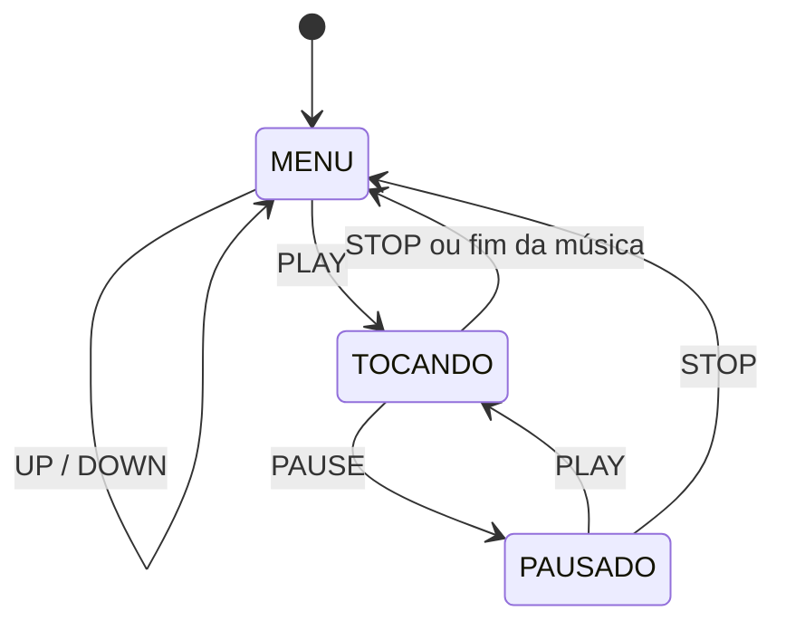

# Reprodutor de Músicas com Arduino UNO

Disciplina: CCP020 - Digital Experience Ultimate
Centro Universitário FEI
Aluno: Henrik Mezedes Batista
Professor: André

Reprodutor de músicas feito no Arduino UNO, com menu num LCD 16x2 (I2C), 4 botões, 3 LEDs e um buzzer pra tocar as músicas. As melodias ficam guardadas na memória FLASH.

<p align="center">
  
  <br><em>Figura 1 - Circuito simulado no Wokwi, com o menu no LCD.</em>
</p>

---

## 1. Introdução
A proposta da disciplina era fazer um reprodutor de músicas com o Arduino UNO. Ele tinha que mostrar um menu de músicas num LCD 16x2, ter botões pra navegar e controlar a música, LEDs mostrando se está tocando ou pausado, e tocar as melodias num buzzer. As músicas tinham que ficar na memória FLASH, porque a RAM do Arduino UNO é bem pequena (2 KB).

O que eu precisava fazer:
- montar o circuito na protoboard com o LCD, os botões, os LEDs e o buzzer;
- fazer um menu que dá pra navegar com os botões UP e DOWN;
- tocar, pausar, continuar e parar a música com PLAY/PAUSE e STOP;
- acender o LED verde quando a música está tocando e o vermelho quando está pausada;
- guardar pelo menos 5 músicas na FLASH.

Além disso, coloquei dois extras: um LED azul que pisca junto com as notas e o menu aparecendo também no Monitor Serial.

---

## 2. Requisitos do projeto

| Requisito | Como fiz |
|---|---|
| Menu de músicas no LCD 16x2 | Mostra a música selecionada e a próxima da lista |
| Botões UP e DOWN | Pinos A0 e A1, a lista dá a volta no final |
| Botão PLAY/PAUSE | Pino A2, toca, pausa e continua de onde parou |
| Botão STOP | Pino A3, para a música e volta pro menu |
| LED verde tocando | Pino 6 |
| LED vermelho pausado | Pino 7 |
| Música no buzzer | Pino 8, com `tone()` |
| Mínimo de 5 músicas na FLASH | 6 músicas em `PROGMEM` |
| Extra: LED no ritmo | Pino 9, acende enquanto a nota toca |
| Extra: tela no computador | Menu também no Monitor Serial |

---

## 3. Como usar

| Botão | No menu | Tocando | Pausado |
|---|---|---|---|
| UP | sobe na lista | - | - |
| DOWN | desce na lista | - | - |
| PLAY/PAUSE | toca a música | pausa | continua |
| STOP | - | volta pro menu | volta pro menu |

LED verde = tocando, LED vermelho = pausado, LED azul = pisca a cada nota. Quando a música acaba ele volta sozinho pro menu.

Músicas (todas de domínio público):
1. Ode à Alegria (Beethoven)
2. Brilha Brilha Estrelinha
3. Parabéns pra Você
4. Jingle Bells
5. Für Elise (Beethoven)
6. Tetris (Korobeiniki)

O menu também aparece no Monitor Serial da Arduino IDE (9600 baud), assim:

```
+----------------+
|>Ode a Alegria  |
| Brilha Brilha  |
+----------------+
```

---

## 4. Materiais

| Arduino UNO | Display LCD 16x2 | LEDs |
|:---:|:---:|:---:|
|  |  |  |

- 1 Arduino UNO
- 1 LCD 16x2 com módulo I2C
- 4 botões 6x6 mm
- 3 LEDs (verde, vermelho e azul)
- 3 resistores de 220 Ω
- 1 buzzer passivo
- 1 protoboard de 830 pontos
- uns 30 jumpers macho-macho
- 4 jumpers macho-fêmea (pro LCD)

O buzzer tem que ser passivo. O ativo só faz um bip fixo e não toca as notas.

---

## 5. Esquema de ligações

| Pino do Arduino | Ligado em |
|---|---|
| 5V | trilho + da protoboard |
| GND | trilho - da protoboard |
| 6 | LED verde (com resistor 220 Ω) |
| 7 | LED vermelho (com resistor 220 Ω) |
| 8 | buzzer (+) |
| 9 | LED azul (com resistor 220 Ω) |
| A0 | botão UP |
| A1 | botão DOWN |
| A2 | botão PLAY/PAUSE |
| A3 | botão STOP |
| A4 | SDA do LCD |
| A5 | SCL do LCD |

O LCD tem um módulo I2C atrás, então em vez de 16 pinos ele usa só 4 fios: GND, VCC, SDA e SCL. No UNO o I2C é sempre nos pinos A4 (SDA) e A5 (SCL). O endereço do módulo normalmente é `0x27`, mas tem alguns que são `0x3F` (o programa de teste mostra qual é). O contraste se ajusta no potenciômetro azul atrás do módulo.

Os botões não têm resistor porque usei o pull-up interno do Arduino (`INPUT_PULLUP`). Solto, o pino lê `HIGH`; apertado, o botão liga o pino no GND e ele lê `LOW`.

---

## 6. Montagem na protoboard

Na protoboard, os 5 furos de cada coluna (a-e ou f-j) são ligados entre si, e o vão do meio separa as duas metades. Os trilhos + e - vão de ponta a ponta, mas nessa protoboard eles são cortados no meio, então precisei de um jumper pra ligar as duas metades. Pra ligar um fio numa perna de componente é só colocar o fio na mesma coluna da perna, do mesmo lado do vão.

<p align="center">
  
  <br><em>Figura 2 - Onde fica cada peça e cada fio. As etiquetas coloridas mostram o pino do Arduino.</em>
</p>

### Alimentação
5V do Arduino no trilho + e GND no trilho -. Um jumper liga o - de cima com o - de baixo, e mais um jumper em cada trilho - passa pela divisão do meio.

### Botões
Cada botão ocupa duas colunas. O fio pro Arduino sai da coluna de uma perna e o fio pro - sai da coluna da outra perna.

<p align="center">
  
  <br><em>Figura 3 - Alimentação e botões.</em>
</p>

Os botões de 4 pernas têm pares de pernas já ligados por dentro. Se o botão ficar como se estivesse sempre apertado, ou não responder, é só girar ele 90°.

### LEDs e buzzer
Cada LED tem um resistor do lado da perna longa (+). O fio do Arduino vai na ponta livre do resistor e a perna curta do LED vai pro -. No buzzer, o + vai no pino 8 e o - no trilho -.

<p align="center">
  
  <br><em>Figura 4 - Montagem completa.</em>
</p>

### LCD
O LCD fica fora da protoboard e é ligado com 4 jumpers macho-fêmea, seguindo a tabela da seção 5. Se a tela acender mas não aparecer nada escrito, tem que girar o potenciômetro atrás do módulo.

<details>
<summary>Posição de cada peça na protoboard</summary>

<br>Protoboard deitada, colunas 1 a 63, fileiras a-e em cima e f-j embaixo.

| Peça | Posição | Fios |
|---|---|---|
| LCD I2C | fora da protoboard | GND → -, VCC → +, SDA → A4, SCL → A5 |
| Botão UP | em cima, colunas 25 e 27 | a25 → A0, a27 → - |
| Botão DOWN | embaixo, colunas 25 e 27 | j25 → A1, j27 → - |
| Botão PLAY/PAUSE | no vão, colunas 34 e 36 | a34 → A2, j36 → - |
| Botão STOP | no vão, colunas 39 e 41 | a39 → A3, j41 → - |
| LED azul | resistor c45-c51, LED a51 (longa) e a52 (curta) | pino 9 → e45, e52 → - |
| LED verde | resistor h45-h51, LED f51 (longa) e f52 (curta) | pino 6 → j45, j52 → - |
| LED vermelho | resistor h54-h60, LED f60 (longa) e f61 (curta) | pino 7 → j54, j61 → - |
| Buzzer | - em a57, + em a60 | pino 8 → e60, e57 → - |

</details>

---

## 7. Funcionamento do código

Arquivos:
- `reprodutor.ino`: programa principal (menu, botões, LEDs e música)
- `musicas.h`: notas e as 6 músicas
- `teste/teste.ino`: programa pra testar o hardware
- `diagram.json` e `libraries.txt`: pra simular no Wokwi
- `fotos/` e `video/`: fotos e vídeo do projeto

### Estados
O programa tem três estados: MENU, TOCANDO e PAUSADO. O que cada botão faz depende do estado em que ele está.



### Músicas na FLASH
O ATmega328P tem 2 KB de RAM e 32 KB de FLASH. Se as músicas ficassem na RAM não ia caber, então elas são declaradas com `PROGMEM` e o programa lê uma nota por vez com `pgm_read_word()`:

```cpp
const int16_t odeAlegria[] PROGMEM = {
  NOTE_E4,4, NOTE_E4,4, NOTE_F4,4, NOTE_G4,4, ...
};

int16_t freq = pgm_read_word(&m.notas[i * 2]);
```

Compilado, o programa usa mais ou menos 35% da FLASH e 33% da RAM.

### Notas
Cada nota é um par `{frequência, figura}`. A frequência é em Hz (`NOTE_A4` = 440, `REST` = pausa) e a figura é 1 pra semibreve, 2 mínima, 4 semínima, 8 colcheia e 16 semicolcheia. Se o número for negativo, a nota é pontuada (dura 1,5x).

A duração sai do BPM de cada música:

```
semibreve (ms) = 60000 * 4 / BPM
duração        = semibreve / figura   (x 1,5 se for pontuada)
```

A nota toca por 90% do tempo e fica 10% em silêncio, senão duas notas iguais seguidas viram uma só.

### Sem delay()
Se eu usasse `delay()` em cada nota, o Arduino ficaria parado e não ia ler os botões durante a música. Então o `loop()` só confere com `millis()` se a nota já acabou:

```cpp
if (millis() - inicioNota >= duracaoNota) {
  notaAtual++;
  tocaNota(notaAtual);
}
```

Pra pausar, o programa guarda quanto tempo da nota já tinha passado. Quando continua, ele toca só o que faltava dessa nota e segue dali.

### Botões
Os botões são lidos por borda, ou seja, só conta quando o botão passa de solto pra apertado, com debounce de 30 ms pra um toque não contar várias vezes.

### Tela no LCD e no Serial
A função `tela()` escreve as mesmas duas linhas no LCD e no Monitor Serial. Isso ajudou porque deu pra testar o menu antes de ligar o LCD.

---

## 8. Como compilar e carregar

1. Coloque `reprodutor.ino` e `musicas.h` numa pasta chamada `reprodutor`.
2. Instale a biblioteca do LCD em Ferramentas > Gerenciar Bibliotecas, procurando "LiquidCrystal I2C" (a do Frank de Brabander).
3. Abra o `reprodutor.ino` na Arduino IDE.
4. Escolha a placa Arduino Uno e a porta (`/dev/ttyUSB0` ou `/dev/ttyACM0` no Linux, `COMx` no Windows).
5. Clique em Carregar.
6. Abra o Monitor Serial em 9600 baud pra ver a tela.

No Fedora eu precisei fazer isso:

```bash
flatpak install flathub cc.arduino.IDE2   # Arduino IDE
sudo usermod -aG dialout $USER            # permissão da porta USB (precisa sair e entrar de novo)
sudo dnf remove brltty                    # se a porta não aparecer (conflito com o chip CH340)
```

O `teste/teste.ino` testa cada peça separada: procura o LCD no I2C e mostra o endereço, acende os LEDs um por um, faz um bip no buzzer e mostra no Monitor Serial qual botão foi apertado. Usei bastante pra achar fio mal encaixado.

---

## 9. Simulação no Wokwi

1. Abra [wokwi.com/projects/new/arduino-uno](https://wokwi.com/projects/new/arduino-uno).
2. Cole o `reprodutor.ino` na aba sketch.ino e o `diagram.json` na aba diagram.json.
3. Crie os arquivos `musicas.h` e `libraries.txt` (na seta do lado das abas, New file) e cole o conteúdo. O `libraries.txt` serve pro Wokwi instalar a biblioteca do LCD.
4. Clique em Start.

No teclado: ↑ = UP, ↓ = DOWN, P = PLAY/PAUSE, S = STOP.

---

## 10. Experimentos

### Simulação no Wokwi
Antes de montar de verdade, simulei o circuito inteiro no Wokwi pra ver se o código funcionava. O menu apareceu certo no LCD, com `>` na música selecionada e a próxima embaixo (Figura 1).

### Montagem física
<!-- Descreva o teste na placa real: o que funcionou, quais problemas apareceram e como foram resolvidos. -->

<p align="center">
  
  <br><em>Figura 5 - Funcionando na placa: Jingle Bells tocando (nota 18 de 51) com o LED azul aceso.</em>
</p>

### Vídeo
<p align="center">
  
  <br><em>Navegando no menu e tocando uma música.</em>
  <br><a href="video/reprodutor-funcionando.mp4">Vídeo com som (.mp4)</a>
</p>

---

## 11. Tecnologias utilizadas
- C++ (Arduino) na Arduino IDE 2
- Bibliotecas `LiquidCrystal_I2C`, `Wire` e `avr/pgmspace.h`
- `tone()`, `noTone()`, `millis()`, `pgm_read_word()` e `INPUT_PULLUP`
- Wokwi pra simular
- Monitor Serial pra depurar
- Git e GitHub

---

## 12. Inspirações e fontes

O formato das músicas como `{nota, figura}`, com número negativo pra nota pontuada, veio do repositório arduino-songs, do Robson Couto. As melodias deste projeto eu transcrevi separado e coloquei em `PROGMEM`.
<https://github.com/robsoncouto/arduino-songs>

Também usei como base o exemplo toneMelody da Arduino, que toca músicas com `tone()` e uma tabela de notas.
<https://www.arduino.cc/en/Tutorial/BuiltInExamples/toneMelody>

Documentação que consultei:
- `tone()`: <https://docs.arduino.cc/language-reference/en/functions/advanced-io/tone/>
- `noTone()`: <https://docs.arduino.cc/language-reference/en/functions/advanced-io/noTone>
- `PROGMEM`: <https://docs.arduino.cc/language-reference/en/variables/utilities/PROGMEM/>
- LiquidCrystal_I2C: <https://github.com/johnrickman/LiquidCrystal_I2C>
- LCD 16x2: <https://docs.arduino.cc/learn/electronics/lcd-displays>
- Blink Without Delay (`millis()`): <https://docs.arduino.cc/built-in-examples/digital/BlinkWithoutDelay>
- Input Pullup Serial: <https://docs.arduino.cc/built-in-examples/digital/InputPullupSerial/>
- Digital Pins: <https://docs.arduino.cc/learn/microcontrollers/digital-pins>
- Botão no Wokwi: <https://docs.wokwi.com/parts/wokwi-pushbutton>
- Multi-tasking the Arduino (Adafruit): <https://learn.adafruit.com/multi-tasking-the-arduino-part-1>

### Ferramentas de apoio
Usei IA (Claude) pra me recomendar fontes de consulta, que são as que estão listadas acima, e pra me ajudar a organizar os tópicos deste README. Também usei o Wokwi pra simular o circuito antes de montar.

---

## 13. Conclusão
Consegui fazer tudo o que o trabalho pedia e ainda coloquei os dois extras, o LED azul no ritmo e o menu no Monitor Serial.

Comecei pelas músicas. Coloquei elas no `musicas.h` como pares de nota e figura, assim a duração de cada nota é calculada pelo BPM e eu não precisei escrever tempo em milissegundos na mão. Como a RAM é muito pequena, as músicas ficaram na FLASH com `PROGMEM`. Depois organizei o programa em três estados (menu, tocando e pausado), o que deixou bem mais fácil saber o que cada botão tem que fazer. Pra conseguir ler os botões enquanto a música toca, não usei `delay()`, e sim `millis()`, e isso também permitiu fazer a pausa continuar do ponto exato onde parou. Antes de montar, testei tudo no Wokwi, e na placa usei o `teste.ino` pra conferir cada componente.

A parte mais difícil foi a montagem física. Com os trilhos cortados no meio, os fios que precisam ficar na mesma coluna da perna e o contraste do LCD, tive que conferir a montagem várias vezes até funcionar. Os botões também deram trabalho e eu precisei fazer vários testes com eles. Os de 4 pernas têm pares ligados por dentro, então dependendo de como estavam encaixados pareciam sempre apertados ou não respondiam. Usei o `teste.ino` pra ver no Monitor Serial qual botão estava sendo lido e acertei a posição deles. No código, um toque às vezes contava mais de uma vez, e isso resolvi com o debounce.

Outra coisa que deu trabalho foi fazer o LED azul acompanhar as notas. Ele tinha que acender e apagar junto com cada nota sem atrapalhar a música. No fim, ele fica aceso só enquanto a nota está soando (os 90% da duração), apaga no silêncio entre uma nota e outra e não acende nas pausas (`REST`), usando o mesmo controle de tempo com `millis()`.

Com esse projeto aprendi como o hardware limita o software: foi a RAM pequena que me fez usar a FLASH, e foi a necessidade de ler os botões durante a música que me fez trocar o `delay()` pelo `millis()`. Também aprendi a usar máquina de estados, o pull-up interno, o LCD por I2C e o `tone()` pra tocar notas. E percebi que testar por partes (primeiro na simulação, depois o hardware, e só depois o programa completo) faz achar os erros bem mais rápido.
